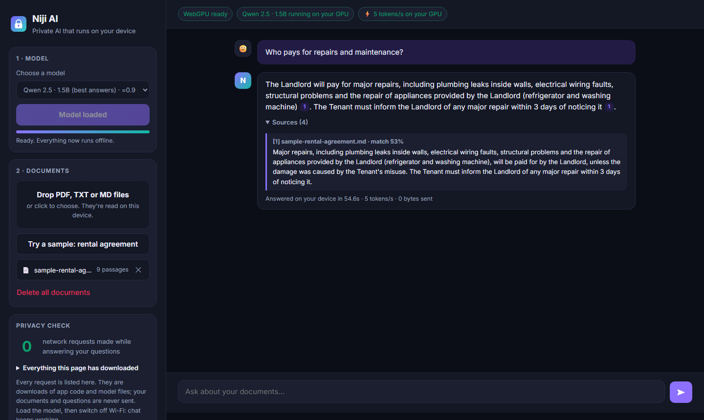

# Niji AI

Chat with your documents using an AI model that runs entirely in your browser. Your files and questions never leave your device: there is no server and no API key.

*Niji* (निजी) means "private" in Hindi.



## Features

- Add PDF, TXT or Markdown files. They are read and indexed on your device.
- Ask questions and get answers with clickable citations to the exact passages used
- The language model runs on your GPU with WebGPU (Qwen 2.5 1.5B, Llama 3.2 1B or SmolLM2 360M)
- Privacy check: a live count of network requests made while answering (it stays at 0)
- Works offline once the model has loaded, and documents are kept only in your browser (IndexedDB)
- Without WebGPU, it still shows the most relevant passages for each question

## How it works

1. **Read:** PDF text is extracted with pdf.js; files are split into overlapping passages.
2. **Index:** each passage is turned into an embedding with all-MiniLM-L6-v2 (transformers.js, runs in the browser).
3. **Search:** a question is embedded the same way and matched against the passages (cosine similarity plus a keyword boost).
4. **Answer:** the top passages are given to a quantized model running with WebLLM, which writes an answer citing them.

## Tech stack

JavaScript, WebGPU, WebLLM, transformers.js, pdf.js, IndexedDB

## Run locally

```bash
git clone https://github.com/Ananyaverma132005/niji-ai.git
cd niji-ai
python -m http.server 8000
```

Open http://localhost:8000 in Chrome or Edge. The first model load downloads the model once (0.3–0.9 GB); after that it loads from the browser's cache.

## Live demo

https://ananyaverma132005.github.io/niji-ai/
